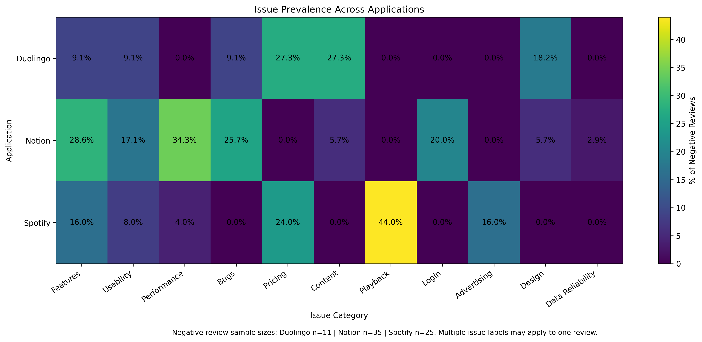

# Sciencia AI – Sentiment Analysis

**Data Source Assessment, User Sentiment Analysis, and Product Issue Classification**

## 1. Project Overview

This project is part of the Sciencia AI sentiment analytics initiative. It explores the feasibility of collecting and analyzing public user reviews from digital platforms to identify customer sentiment, product pain points, and potential areas for product improvement.

The project combines data source assessment, review data collection, sentiment analysis, issue classification, and manual validation to explore how user feedback can support product and business decisions.

The current analysis focuses on three applications: Notion, Duolingo, and Spotify.

## 2. Project Objectives

- Evaluate the accessibility and suitability of potential user review data sources.
- Test practical review data collection from Google Play.
- Assess data completeness, duplication, and language quality.
- Apply sentiment analysis to identify positive, neutral, and negative user feedback.
- Classify negative reviews into product-related issue categories.
- Compare issue prevalence across different applications.
- Manually validate automated issue classification results.
- Explore how review insights can support product improvement and competitive analysis.

## 3. Data Collection

A bounded Google Play data collection test was conducted using the third-party Python package `google-play-scraper`.

Three applications were selected:

- Notion
- Duolingo
- Spotify

**Collection results:**

| Metric | Result |
|---|---:|
| Applications tested | 3 |
| Reviews collected | 600 |
| Reviews per application | 200 |
| Collection batches per application | 2 |
| Duplicate review IDs across batches | 0 |
| Reviews retained after preliminary English-language filtering | 489 |

**Important:** `google-play-scraper` is an unofficial third-party tool. This test demonstrates practical data accessibility under the conditions tested; it does not establish official Google API support, guaranteed permission, or long-term collection reliability.

## 4. Data Processing and Quality Assessment

The collected reviews were examined for:

- Missing review text and key metadata
- Duplicate review IDs across collection batches
- Language identification and filtering
- Review text availability and usability

The preliminary dataset contained 489 reviews retained as English-language reviews for further analysis.

Language identification is approximate and may not perfectly classify short, mixed-language, or ambiguous reviews.

## 5. Sentiment Analysis

VADER was applied to the 489 retained reviews to classify sentiment using compound scores.

| Sentiment | Number of Reviews | Percentage |
|---|---:|---:|
| Positive | 346 | 70.8% |
| Negative | 84 | 17.2% |
| Neutral | 59 | 12.1% |

A small number of predictions were manually reviewed and corrected. These corrections were documented separately and should not be interpreted as a fully validated human-labeled sentiment dataset.

## 6. Issue Classification

Negative reviews were classified into 12 product-related issue categories:

1. Advertising
2. Bugs and Errors
3. Content Quality
4. Data Loss and Reliability
5. Features and Functionality
6. Login and Access
7. Performance
8. Playback Experience
9. Pricing
10. Product Design
11. Recommendations
12. Usability

A total of 78 out of 84 negative reviews received at least one issue label, representing **92.86% labeling coverage**.

Multiple labels can be assigned to a single review when it describes more than one issue.

Labeling coverage measures the proportion of negative reviews receiving at least one label; it does not represent classification accuracy.

## 7. Issue Prevalence Analysis

Issue prevalence analysis was conducted to compare the distribution of negative user feedback across the three applications.

The analysis explores:

- Which product issues appear most frequently in negative reviews.
- How complaint patterns differ across applications.
- Which categories may deserve further investigation by product teams.

The heatmap below summarizes issue prevalence across the applications.



The initial findings suggest different complaint patterns:

- **Notion:** Features and functionality, performance, bugs, and usability.
- **Duolingo:** Content quality, features and functionality, and product design.
- **Spotify:** Pricing, playback experience, and advertising.

These findings are exploratory and reflect only the collected sample. They should not be interpreted as representative of the overall user population or definitive comparisons of product quality.

## 8. Manual Validation

Manual validation was conducted to assess the quality of automated issue classification.

The evaluation used True Positives (TP), False Positives (FP), and False Negatives (FN) to calculate Precision, Recall, and F1 Score.

### 8.1 Validation by Application

| Application | Precision | Recall | F1 Score |
|---|---:|---:|---:|
| Duolingo | 0.800 | 0.533 | 0.640 |
| Notion | 0.875 | 0.636 | 0.737 |
| Spotify | 0.800 | 0.571 | 0.667 |

Notion achieved the highest F1 score among the three applications in the manually evaluated sample.

### 8.2 Validation by Issue Category

| Issue Category | Precision | Recall | F1 Score |
|---|---:|---:|---:|
| Advertising | 1.000 | 0.500 | 0.667 |
| Bugs and Errors | 1.000 | 0.625 | 0.769 |
| Content Quality | 1.000 | 0.667 | 0.800 |
| Features and Functionality | 0.800 | 0.267 | 0.400 |
| Login and Access | 1.000 | 0.667 | 0.800 |
| Performance | 0.833 | 0.833 | 0.833 |
| Playback Experience | 0.857 | 0.750 | 0.800 |
| Pricing | 1.000 | 0.875 | 0.933 |
| Product Design | 0.500 | 1.000 | 0.667 |
| Usability | 0.250 | 0.250 | 0.250 |

### 8.3 Overall Validation Results

Based on the aggregated TP, FP, and FN counts across the three applications:

| Metric | Result |
|---|---:|
| True Positives | 34 |
| False Positives | 7 |
| False Negatives | 24 |
| Micro-averaged Precision | 82.9% |
| Micro-averaged Recall | 58.6% |
| Micro-averaged F1 Score | 68.7% |

The results indicate that the classification approach demonstrates relatively strong precision but has room for improvement in recall.

In particular:

- **Pricing** achieved an F1 score of 0.933, indicating strong performance in the manually evaluated sample.
- **Performance** achieved an F1 score of 0.833.
- **Features and Functionality** showed relatively low recall (0.267), suggesting that the current rules may miss relevant user complaints.
- **Usability** showed low precision and recall (both 0.250), indicating a need to refine category definitions and classification rules.

These metrics are based on a limited manual validation sample and should be treated as preliminary estimates rather than definitive measures of model performance.

## 9. Business Implications

The analysis demonstrates how public user reviews can provide structured insights into product experience and competitive positioning.

Potential applications include:

- **Product Prioritization:** Identify recurring complaints that may require product improvements.
- **Competitive Analysis:** Compare user complaint patterns across competing applications.
- **Customer Experience Monitoring:** Track changes in user feedback and identify emerging issues.
- **Analytics Quality Improvement:** Use manual validation results to identify weaknesses in automated classification.

The validation results also highlight the importance of improving issue detection, particularly for broad categories such as Features and Functionality and Usability.

## 10. Limitations

- The Google Play collection test used an unofficial third-party scraper.
- The sample is limited to three applications and 200 reviews per application.
- Long-term collection reliability and repeatability have not been established.
- Language detection may produce errors, particularly for short or mixed-language reviews.
- VADER may misinterpret context, sarcasm, negation, and informal language.
- Issue classification relies on keyword-based rules and limited manual validation.
- Manual validation results may be sensitive to sample size and category definitions.
- G2 access and review-text availability have not yet been established.

## 11. Repository Structure

```text
sciencia-ai-sentiment-analysis/
│
├── README.md
├── sentiment.ipynb
│
├── 01_source_assessment/
├── 02_data_collection/
├── 03_test_results/
├── 04_documentation/
│
└── figures/
    └── issue_prevalence_heatmap.png
```

## 12. Project Status and Next Steps

**Current Status:** Preliminary data source validation, review collection, exploratory sentiment analysis, issue classification, issue prevalence analysis, and initial manual validation completed.


*This project represents an exploratory phase of the Sciencia AI sentiment analytics initiative. Findings are preliminary and intended to demonstrate data collection feasibility, analytical methods, and potential business applications.*
